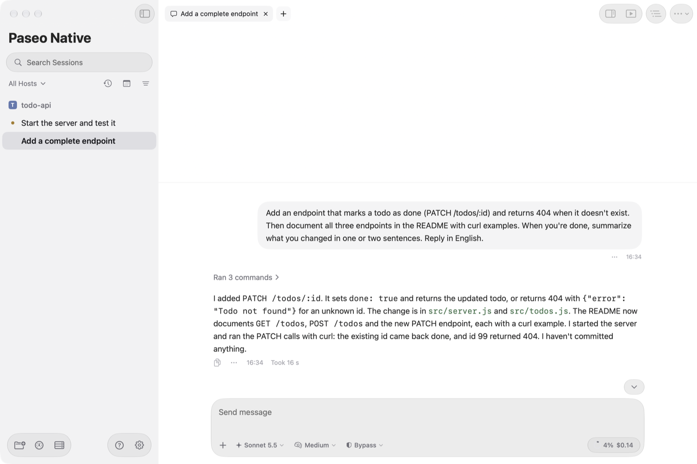
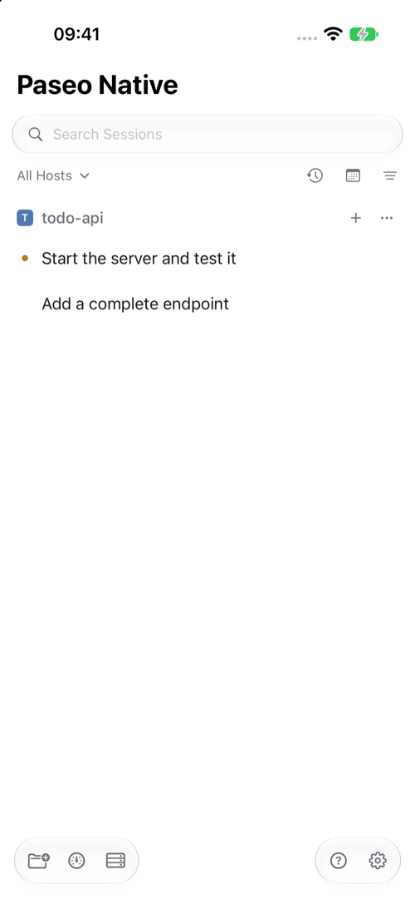
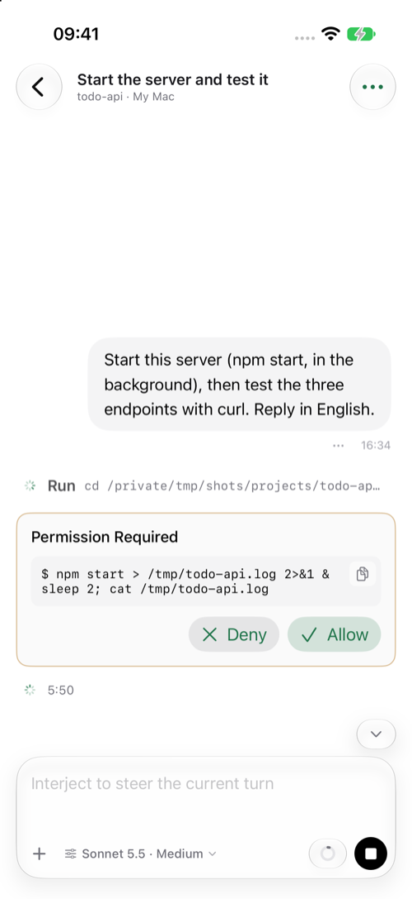
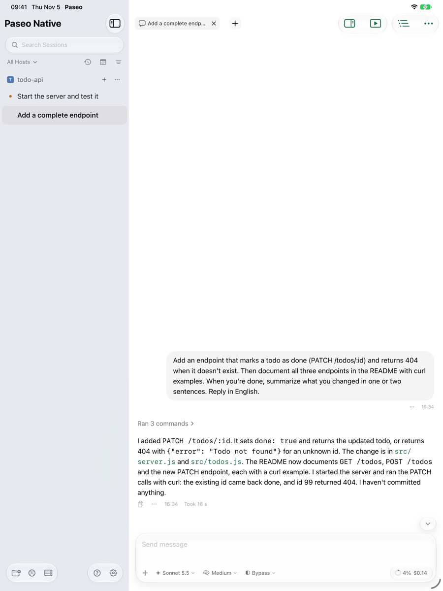
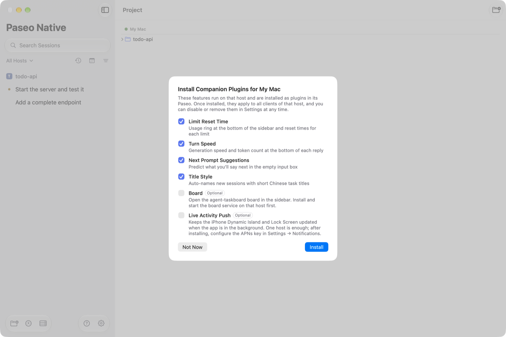
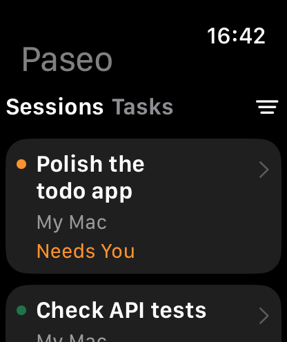
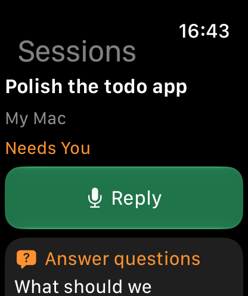
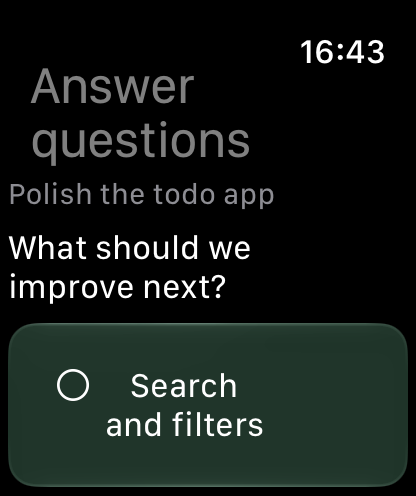
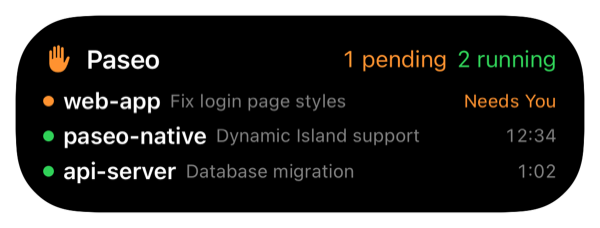
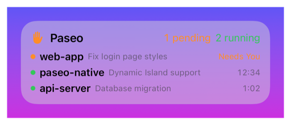

# Paseo Native

An unofficial native client for [Paseo](https://paseo.sh) on Mac, iPhone and iPad, from one SwiftUI codebase.

An **Apple Watch companion (watchOS 11+)** is included: view sessions and schedules, dictate replies, answer question forms, and review permission requests through the paired iPhone. It uses Liquid Glass on watchOS 26+ and standard controls on older systems. See [building and testing the watch companion](docs/watch-companion.md).

> **Not affiliated with the Paseo project.** Like the official apps, it connects to the Paseo daemon on your own
> computer, and can be installed and used side by side with them. The interface is available in English and Simplified Chinese and follows your system language (from 1.0.8).

[中文说明](README.md)

<p align="center"></p>

<p align="center">
  
  
  
</p>

## Features

- **Native UI**: SwiftUI with Liquid Glass on macOS / iOS 26 and later, and standard buttons and rounded backgrounds on iOS 18; long sessions scroll smoothly
- **On par with the official client**: multiple machines, sessions, timeline, permissions, terminals, files, diffs,
  Git and pull requests, schedules, command palette
- **Mac**: menu bar status, reply / approve / deny from notifications, Quick Look, drag files out, an optional
  built-in manager that runs the daemon without the official desktop app (switch back any time), update notifications
- **iPhone / iPad**: Live Activities and Dynamic Island, notifications with Approve / Deny / Reply — pushed by a
  plugin on *your own* machine with *your own* APNs key, no third-party server
- **Apple Watch**: session status and messages, previewed dictation replies, single/multiple-choice and custom answers, permission requests, and read-only schedules through the paired iPhone
- **Companion plugins (optional)**: usage limits, turn speed, next-input suggestions, titles

It is only a client: it doesn't include or modify the Paseo daemon, and your agents keep running on your computer
with the Claude Code / Codex accounts logged in there.

## Download

| Platform | How |
|---|---|
| **Mac** | Download `Paseo-Native-x.y.z.dmg` from [Releases](https://github.com/gavinguo521/paseo-native/releases/latest) and drag "Paseo Native" into Applications. Signed and notarized by Apple. It installs as `Paseo Native.app` and does not replace the official `Paseo.app` |
| **iPhone / iPad** | No prebuilt package; build it with Xcode, see [iPhone / iPad](#iphone--ipad) |
| **Apple Watch** | Build with the iPhone app; communication requires its paired iPhone. See [Apple Watch](#apple-watch) |
| **Android** | Use the official app; both can connect to the same machine |

Requires macOS 26 / iOS 18 / iPadOS 18. Apple Watch requires watchOS 11+ and a paired iPhone running this app on iOS 18+. iOS / iPadOS 18 uses compatible styling while 26 and later retains Liquid Glass, with the same feature logic. Also requires a computer running a Paseo daemon (bundled with the official desktop app;
Paseo Native can also install one). Tested with Paseo v0.15.

## Getting started

- **The official desktop app already runs on this Mac**: Add machine → 直连地址 (direct address) → `localhost:6767`.
- **No Paseo on this Mac yet**: Settings → Machines → This Mac → "在这台 Mac 上安装并运行 Paseo…" (install and run
  Paseo here). It downloads the official CLI (plus Node if needed, about 600 MB), starts it at login and adds the machine.
- **Another computer, or on iPhone / iPad**: run `paseo daemon pair` there, then Add machine → 配对链接 (pairing link)
  and paste it, or scan the QR code. Enter the daemon password if it has one.

Pairing links go through the Paseo relay and are end-to-end encrypted; a link is a key to that machine and is stored
only in the Keychain. Paseo Native and the official desktop, mobile and web apps can all be connected to the same
machine at once and see the same sessions.

## Companion plugins (optional)



Plugins run on the **machine with the daemon** and work for every client of that machine. **All of them are
optional.** The app offers them once when you first connect a machine ("以后再说" skips them); manage them later in
Settings → Machines → Plugins.

| Plugin | What it does | Note |
|---|---|---|
| Usage reset | Claude / Codex usage and when each limit resets | Reads data Paseo already fetches |
| Turn speed | Tokens per second under each reply | Parses the CLI's local logs |
| Next input | Suggests your next message in the empty composer (Tab to accept) | Calls Claude (Haiku by default) or Codex once per turn, **uses a little of that account's quota** |
| Title style | Short Chinese titles for new sessions | One model call per new session |
| Board | Opens an [agent-taskboard](https://github.com/gavinguo521/agent-taskboard) board | Only for agent-taskboard users |
| Live Activity push | Updates the Dynamic Island and sends notifications while the app is in the background | Needs a paid developer account, see below |

Paseo plugins run unsandboxed in the daemon; source: [paseo-plugins](https://github.com/gavinguo521/paseo-plugins),
[title-style](https://github.com/gavinguo521/title-style), or the [Paseo plugin registry](https://paseo.sh/plugins).

## Replacing the official desktop app (optional), and switching back

Settings → Machines → This Mac shows who runs the daemon. When it is the official app, "改由本 App 运行…" (run it
with this app) quits the official app, stops its daemon and starts one managed by Paseo Native on the same
`~/.paseo`, launched at login; the official app can then be uninstalled. Running sessions are interrupted. It still
uses the official `@getpaseo/cli` (in `~/Library/Application Support/Paseo Native`, linked from
`~/.local/bin/paseo`). **Machine ID, pairings, sessions and plugins all live in `~/.paseo` and stay the same**, so
phones and other computers don't need to pair again. Already uninstalled the official app? The page then says no
daemon is running: use "在这台 Mac 上安装并运行 Paseo…", which reuses the same `~/.paseo`.

To switch back, "切回官方 App…" on the same page stops Paseo Native's daemon, removes its login item, points
`~/.local/bin/paseo` back and opens the official app, which takes over (reinstall it from [paseo.sh](https://paseo.sh)
first if you removed it). Don't let both apps run a daemon at the same time.

## iPhone / iPad

Apple doesn't allow installing iOS apps from outside the App Store, so build it yourself:

1. Xcode 26 (signed in with your Apple ID) and `brew install xcodegen`
2. ```sh
   git clone https://github.com/gavinguo521/paseo-native.git && cd paseo-native
   cp Config/Local.xcconfig.example Config/Local.xcconfig
   ```
   Set `DEVELOPMENT_TEAM` and `PASEO_BUNDLE_ID` in it. **With a free Apple ID**, also uncomment
   `PASEO_IOS_ENTITLEMENTS = App/Paseo-iOS-Free.entitlements` (free teams can't sign the push capability).
3. `xcodegen generate && open Paseo.xcodeproj`; trust the SwiftTerm build plugin when Xcode asks.
4. Connect the device (enable Settings → Privacy & Security → Developer Mode the first time), pick it in Xcode, set
   the Run configuration to **Release** (Product → Scheme → Edit Scheme; Debug scrolls slowly) and run.
5. With a free Apple ID, trust yourself in Settings → General → VPN & Device Management on the device.

With a free Apple ID the app expires after 7 days, at most 3 self-built apps can be installed, and background
notifications are unavailable (the Live Activity still updates while the app is open). A paid Apple Developer account
(USD 99/year) removes these limits and allows TestFlight.

## Apple Watch

Check session status and recent messages from your wrist. Dictate a reply, preview it, then explicitly send it. Question forms support single/multiple selections, custom answers, and multiple questions. Review permission requests that fit on the watch, and read schedules and run results. Oversized or unsupported requests direct you back to the iPhone.

<p align="center">
  
  
  
</p>

*Screenshots from the watchOS 27.2 simulator with sample sessions, without personal project or machine information.*

**Install**: build and install the iPhone app using the steps above. Pair a watch running watchOS 11+ with that iPhone. Select the `PaseoWatch` scheme and paired watch in Xcode, use the same signing team as the iPhone app, and build and run. Enable Developer Mode on the watch when prompted. Connect a host in Paseo on the iPhone before opening the watch app. See the [full build and test guide](docs/watch-companion.md#build-and-test).

**Connection and scope**: this first version communicates through the paired iPhone and does not connect independently; an iPad cannot replace the paired iPhone. Cached content and its last refresh time remain available when the phone cannot be reached. watchOS 26+ uses Liquid Glass; older supported systems use compatible styling. Installation currently requires building from source; there is no standalone watch download.

The English and Chinese session list, details, and question screens have been checked in the simulator. Background wake-up while the phone is locked, real dictation delivery, and notification routing remain subject to the [physical-device validation record](docs/watch-companion.md#build-and-test).

## Dynamic Island and notifications (optional, paid developer account)

<p>
  
  
</p>

Running and waiting sessions from all machines are combined into one Live Activity (Dynamic Island and lock screen on
iPhone, lock screen on iPad); tap a row to open the session. In the foreground it updates with no setup. For updates
and "finished / failed / needs approval" notifications in the background:

1. Create an APNs key (.p8) in your Apple Developer account (Keys → Apple Push Notifications service; Sandbox for
   Xcode installs, Production for TestFlight; Topic Specific → your bundle ID). It must belong to the team that signs
   the app. The .p8 can be downloaded only once.
2. Install the Live Activity push (灵动岛推送) plugin on **one** machine that stays online.
3. On the iPhone: Settings → 通知 → 灵动岛推送 → 配置 APNs 密钥, enter Team ID and Key ID, pick the .p8 file and environment.

The key is stored only on that machine (`~/.paseo/live-activity/`), which sends pushes to Apple directly.

## Updating

- **Mac**: checks GitHub at launch, on returning to the foreground, and periodically while running, with automatic
  requests at least 30 minutes apart. Each version is announced once; Later reminds you after 24 hours, while Skip
  suppresses that version. Check manually or download from the app menu / Settings → About, where automatic checks
  can also be disabled. Discovered downloads remain available. Nothing installs automatically; quit apps do not
  check, and older versions retain their original schedule. Drag the new app into Applications to install it;
  settings and machines are kept.
- **Daemon**: updated by the official app, or with "更新到 x.y.z" in Settings → Machines → This Mac when Paseo Native runs it.
- **iPhone / iPad**: `git pull`, `xcodegen generate`, run again from Xcode.

## Privacy and network

No analytics and no servers of our own. The app connects only to your daemons (through the Paseo relay, end-to-end
encrypted, or a direct address), `api.github.com` for update checks at least 30 minutes apart (Mac, can be turned off), jsDelivr to
render Mermaid diagrams, and nodejs.org / npm only when installing or updating the daemon. Pairing links and passwords
stay in the Keychain. The Mac app is not sandboxed so it can show local files referenced in replies and manage the
local daemon.

## Uninstalling (Mac)

If Paseo Native runs the daemon, switch back to the official app or stop it first; then move the app to the Trash.
To clean up fully, also remove `~/Library/Application Support/Paseo Native` and
`~/Library/LaunchAgents/sh.paseo.native.daemon.plist`. **Don't delete `~/.paseo`** — it is Paseo's own data.

## Feedback

There is also a WeChat group (in Chinese), see the [Chinese README](README.md#反馈与交流). Please open an [issue](https://github.com/gavinguo521/paseo-native/issues); attach the file from Settings → About →
导出诊断信息 (export diagnostics) — it contains no conversation content, and pairing links and passwords are redacted.

## Building the Mac app

Same as steps 1–3 above, then run "My Mac" in Xcode. Unit tests: `cd PaseoKit && swift test`; command-line builds
need `-skipPackagePluginValidation` (SwiftTerm's build plugin). Forks can set `PASEO_RELEASES_REPO` in
`Config/Local.xcconfig` to check their own releases.

## License

[Apache License 2.0](LICENSE). See [NOTICE](NOTICE) for attributions. "Paseo" is the name of the Paseo project; this
is an unofficial community client.
