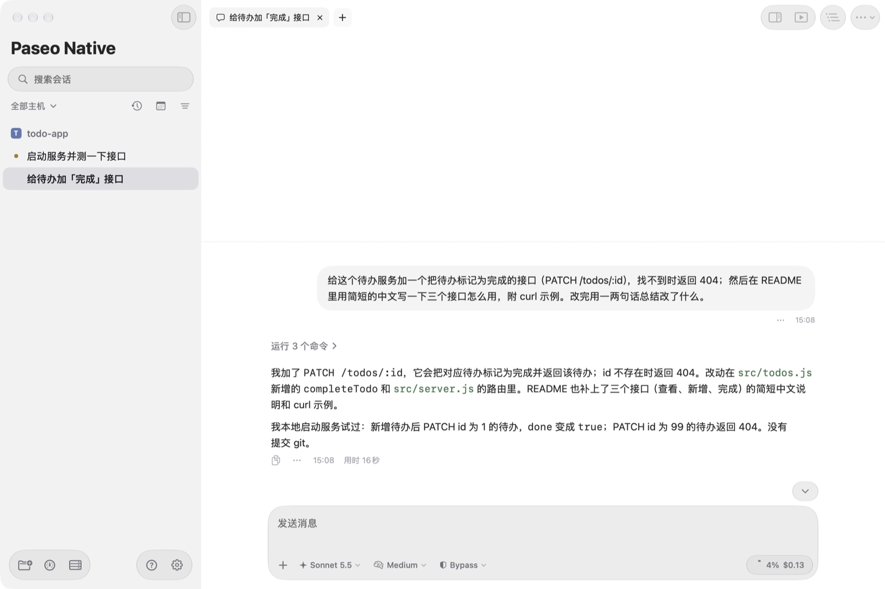
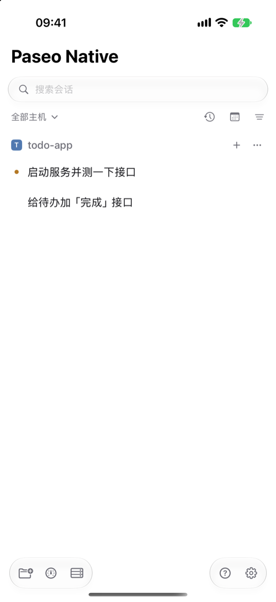
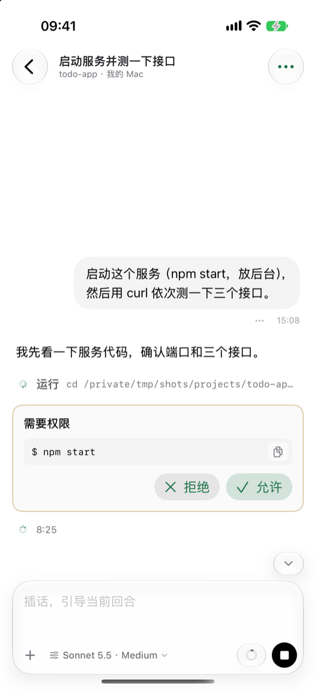
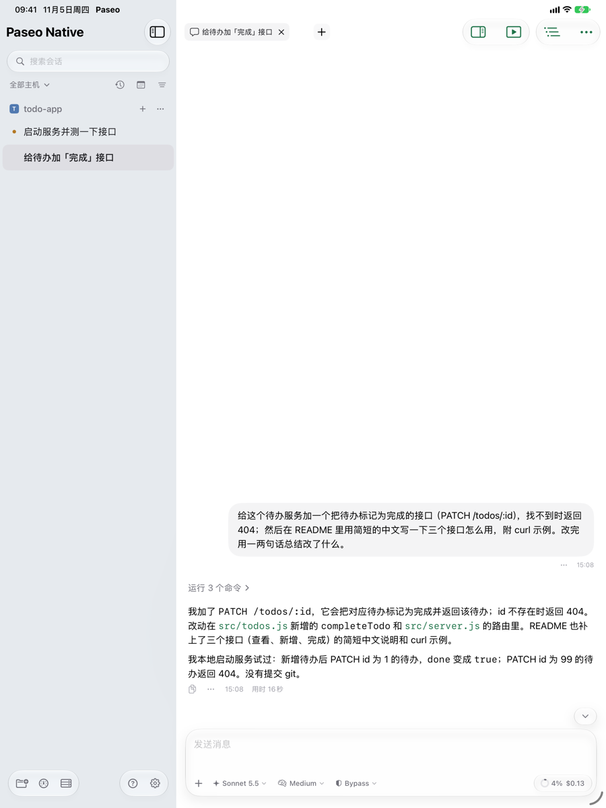
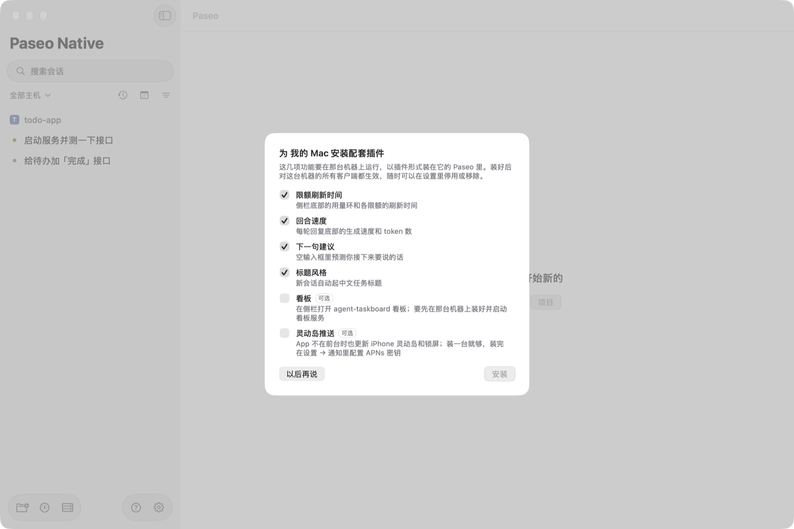
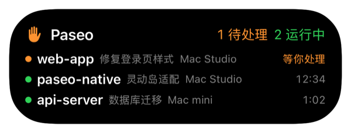
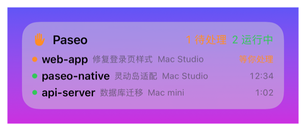

# Paseo Native

非官方的 [Paseo](https://paseo.sh) 原生客户端，Mac、iPhone、iPad 共用一套 SwiftUI 代码。

> **与 Paseo 官方无关。** 它和官方 App 一样，连接你自己电脑上的 Paseo daemon；可以和官方 App 同时装、同时用。界面只有简体中文。

[English](README.en.md)

<p align="center"></p>

<p align="center">
  
  
  
</p>

**目录**：[有什么](#有什么) · [下载](#下载) · [开始使用](#开始使用) · [配套插件](#配套插件可选) · [替代官方桌面 App](#替代官方桌面-app可选以及怎么切回官方) · [iPhone / iPad 版安装](#iphone--ipad-版安装) · [灵动岛和推送](#灵动岛和推送可选需要付费开发者账号) · [更新](#更新) · [隐私与网络](#隐私与网络) · [卸载](#卸载) · [常见问题](#常见问题) · [交流群](#反馈与交流)

## 有什么

- **原生界面**：SwiftUI + macOS / iOS 26 的 Liquid Glass，长会话滚动流畅
- **功能对齐官方客户端**：多台机器、会话、时间线、权限审批、终端、文件、改动、Git 与 PR、计划任务、命令面板
- **Mac**：菜单栏显示等你处理和运行中的会话；在通知里直接回复、允许或拒绝；快速查看、拖出文件；可以不开官方桌面 App，由本 App 在后台运行 daemon（随时切回官方）；有新版本时提示更新
- **iPhone / iPad**：灵动岛和锁屏实时活动；带「允许 / 拒绝 / 回复」按钮的推送——用**你自己的** APNs 密钥，由你自己机器上的插件推送，不经过任何第三方服务器
- **配套插件（可选）**：限额刷新时间、回合速度、下一句建议、中文标题，连上机器时一键安装

**它不是什么**：它只是客户端，不包含也不修改 Paseo daemon；agent 照样跑在你的电脑上，用的是你电脑上已登录的 Claude Code / Codex 等账户。

## 下载

| 平台 | 怎么装 |
|---|---|
| **Mac** | 到 [Releases](https://github.com/gavinguo521/paseo-native/releases/latest) 下载 `Paseo-Native-x.y.z.dmg`，打开后把「Paseo Native」拖进「应用程序」。已签名、已经过苹果公证，双击就能打开；装好叫「Paseo Native.app」，不会覆盖官方的 Paseo.app |
| **iPhone / iPad** | 暂不提供安装包，需要用 Xcode 自己编译安装，见「[iPhone / iPad 版安装](#iphone--ipad-版安装)」 |
| **安卓** | 没有，继续用官方 App；两边可以连同一台机器 |

**系统要求**：macOS 26 / iOS 26 / iPadOS 26（用了 26 才有的界面，更早的系统装不上）。另外需要一台跑着 Paseo daemon 的电脑（官方桌面 App 自带；没有的话本 App 可以帮你装，见下文）。已用 Paseo v0.15 测试。

## 开始使用

按你的情况选一种：

**A. 这台 Mac 上已经在用官方桌面 App**
添加机器 → 选「直连地址」→ 填 `localhost:6767` →「连接并添加」。daemon 默认只监听本机 6767 端口，本机直连最快，不用配对。

**B. 这台 Mac 上还没有 Paseo**
打开「设置 → 机器 → 这台 Mac」→「在这台 Mac 上安装并运行 Paseo…」。本 App 会下载官方的 Paseo 命令行（机器上没有 Node 20+ 时一并下载 Node，共约 600 MB，1～2 分钟），设成开机自动运行，并自动把「这台 Mac」加到机器列表。

**C. 连别的电脑（或在 iPhone / iPad 上用）**
1. 在那台电脑上执行 `paseo daemon pair`，会显示一个二维码和配对链接（官方桌面 App 的设置里、或本 App 的「设置 → 机器 → 某台机器 → 显示配对二维码和链接」也能看到）。
2. 本 App →「添加机器」→「配对链接」，粘贴链接；iPhone / iPad 可以直接「扫描二维码」。
3. daemon 设了密码的，把密码填进「daemon 密码」；没设就留空。

配对链接经 Paseo 的中继连接，**端到端加密**，在外面用手机也能连回家里或公司的电脑。配对链接等同于那台机器的钥匙，只保存在本机钥匙串里，不要发给别人。

**和官方 App 一起用**：完全可以。本 App 和官方的桌面、手机、网页 App 可以同时连同一台机器，看到的是同一批会话，在哪边操作都会同步。

## 配套插件（可选）



插件装在 **daemon 所在的那台机器**上，装好后对这台机器的所有客户端都生效（包括官方 App）。**全部是可选的**，不装也能正常使用全部基本功能。

| 插件 | 作用 | 需要注意 |
|---|---|---|
| 限额刷新时间 | 侧栏底部显示 Claude / Codex 用量，以及各限额具体什么时候刷新 | 只读 Paseo 本来就会取的用量数据，不额外联网 |
| 回合速度 | 每轮回复底部显示生成速度和 token 数 | 在本机解析 CLI 的日志，只取时间和 token 数 |
| 下一句建议 | 空输入框里预测你接下来要说的话，Mac 按 Tab 采用 | 每轮结束后调用一次 Claude（默认 Haiku）或 Codex，**会消耗该账户少量用量**；需要那台机器装了 Claude Code 或 Codex CLI |
| 标题风格 | 新会话自动起简短的中文任务标题 | 每个新会话调用一次模型起标题，消耗少量用量 |
| 看板 | 在侧栏打开 [agent-taskboard](https://github.com/gavinguo521/agent-taskboard) 看板 | 只对用 agent-taskboard 的人有用，要先装好并启动它 |
| 灵动岛推送 | App 不在前台时，也能推送更新 iPhone 灵动岛和通知 | 需要付费开发者账号，见[下文](#灵动岛和推送可选需要付费开发者账号) |

- **怎么装**：第一次连上一台机器时会弹窗问一次，勾选要的点「安装」；点「以后再说」就不装，也不会再问。之后想装、停用或移除，在「设置 → 机器 → 插件」里操作。
- **安全**：Paseo 插件运行在 daemon 里、没有沙盒，装之前可以看源码：[paseo-plugins](https://github.com/gavinguo521/paseo-plugins)（限额刷新时间、回合速度、下一句建议、看板、灵动岛推送）、[title-style](https://github.com/gavinguo521/title-style)（标题风格），也可以在 [Paseo 插件市场](https://paseo.sh/plugins) 查看。

## 替代官方桌面 App（可选），以及怎么切回官方

只想用 Paseo Native 时，可以让它接管本机的 daemon，不再需要打开官方桌面 App：

1. 打开「设置 → 机器 → 这台 Mac」，这里会显示 daemon 现在由谁运行。
2. 显示「由官方 Paseo App 运行」时，点 **「改由本 App 运行…」**。本 App 会退出官方 App、停掉它的 daemon，再用同一个 `~/.paseo` 启动自己管理的 daemon，并设为开机自动启动。正在运行的会话会被中断（确认框里会写有几个）。
3. 之后官方 App 可以卸载，也可以留着。

> 已经先把官方 App 卸载了也没关系：这时页面显示「没有运行 Paseo」，点「在这台 Mac 上安装并运行 Paseo…」即可。daemon 用的仍是原来的 `~/.paseo`，机器 ID 和配对都不变，不会丢数据。

daemon 用的仍是官方的 `@getpaseo/cli`，装在「~/Library/Application Support/Paseo Native」里，`~/.local/bin/paseo` 会指向它，所以终端里的 `paseo` 命令照常能用。**机器 ID、配对、会话、插件都在 `~/.paseo`，切换前后完全不变**，手机和其他电脑不用重新配对。

由本 App 运行后，同一个页面还有：「重启」「停止」（停止后开机也不再启动，直到点「启动」）、「检查更新 / 更新到 x.y.z」（只升级 daemon）、「日志」。

**切回官方**：同一个页面点 **「切回官方 App…」**。本 App 会停掉自己的 daemon、取消它的开机启动、把 `~/.local/bin/paseo` 指回原来的命令行，再打开官方 App 由它接管，数据同样不变。本 App 装的命令行会留着，以后再切回来不用重装。这个按钮只在装了官方 App 时出现；如果之前把官方 App 卸载了，先从 [paseo.sh](https://paseo.sh) 重新下载安装，再回到这里切换。

> 切换后不要再同时打开官方 App 让它也起一个 daemon，两个 daemon 会抢同一个 `~/.paseo`。官方 App 如果设了「登录时打开」，记得关掉。

## iPhone / iPad 版安装

苹果不允许在 App Store 以外随意分发 iOS App，所以需要自己用 Xcode 编译安装：

1. 准备一台装了 **Xcode 26** 的 Mac，安装 XcodeGen：`brew install xcodegen`。Xcode → Settings → Accounts 里登录你的 Apple ID。
2. 获取代码并填写签名配置：
   ```sh
   git clone https://github.com/gavinguo521/paseo-native.git && cd paseo-native
   cp Config/Local.xcconfig.example Config/Local.xcconfig
   ```
   编辑 `Config/Local.xcconfig`（文件里有注释）：
   - `DEVELOPMENT_TEAM`：你的 Team ID（Xcode → Settings → Accounts 里选中账号能看到）
   - `PASEO_BUNDLE_ID`：一个你自己的 bundle ID，如 `com.yourname.paseo-native`
   - **用免费 Apple ID 的**，把 `PASEO_IOS_ENTITLEMENTS = App/Paseo-iOS-Free.entitlements` 这一行的注释去掉（免费账号不支持推送能力，不改的话签名会报错）
3. `xcodegen generate && open Paseo.xcodeproj`。第一次编译 Xcode 会问是否信任 SwiftTerm 的构建插件，选「Trust & Enable」。
4. 用数据线连上 iPhone / iPad。第一次需要在设备上打开「设置 → 隐私与安全性 → 开发者模式」并重启。
5. 在 Xcode 顶部选择你的设备；Product → Scheme → Edit Scheme → Run 把 Build Configuration 改成 **Release**（Debug 版滚动会卡）；点运行。
6. 用免费 Apple ID 的，第一次打开会提示「不受信任的开发者」：在设备上「设置 → 通用 → VPN 与设备管理」里信任你的 Apple ID。

| | 免费 Apple ID | 付费开发者账号（99 美元/年） |
|---|---|---|
| 能否安装 | 可以 | 可以 |
| 有效期 | 7 天，过期后用 Xcode 重新运行一次 | 1 年 |
| 其他限制 | 同时最多 3 个自己编译的 App | 无 |
| 推送通知、灵动岛后台更新 | 不支持（App 在前台时灵动岛照常更新） | 支持 |
| 分发给同事 | 不行 | 可以用 TestFlight（`scripts/release-ios.sh`） |

装好后先「添加机器」，见「[开始使用](#开始使用)」的 C。

## 灵动岛和推送（可选，需要付费开发者账号）

<p>
  
  
</p>

所有机器上运行中、等你处理的会话合成一个实时活动，显示在 iPhone 的灵动岛和锁屏上（iPad 显示在锁屏上），点某一行直接打开那个会话。可以在「设置 → 通知」里关掉。

- **App 在前台时**：直接更新，**不需要任何配置**，免费 Apple ID 也行。
- **App 在后台时**：iOS 不让 App 自己保持连接，要由电脑通过 Apple 推送来更新。按下面配置后，灵动岛会在后台持续更新，会话完成、出错或需要你批准时还会收到通知，可以直接在通知上「允许 / 拒绝 / 回复」。

配置步骤：

1. **建 APNs 密钥**：登录 [Apple 开发者后台](https://developer.apple.com/account/resources/authkeys/list) → Keys → 新建，勾选 Apple Push Notifications service；Environment 按安装方式选——Xcode 直接安装的选 **Sandbox**，TestFlight 安装的选 **Production**；Key Restriction 选 Topic Specific，填你的 bundle ID。下载得到的 `.p8` 文件**只能下载一次**，保存好，并记下 Key ID。密钥必须和签名 App 的是**同一个开发者账号**。
2. **装推送插件**：在其中一台机器上安装「灵动岛推送」插件（「设置 → 机器 → 插件」，或首次连接时的弹窗里勾选）。**装一台就够**，它会把已关联机器上的会话一起算进来；这台机器要一直开着、联网。
3. **配置密钥**：iPhone 上打开「设置 → 通知 → 灵动岛推送」→「配置 APNs 密钥…」，填 Team ID（默认已填好签名团队）、Key ID，选 `.p8` 文件和环境，保存。插件验证密钥格式无误后才保存。

密钥只保存在装插件的那台机器上（`~/.paseo/live-activity/`），推送由那台机器直接发给 Apple，不经过任何第三方。

## 更新

**Mac 版**：
- 1.0.7 起会自动检查更新：启动后每天最多查一次 GitHub，有新版本时弹窗，可以「下载新版本」「跳过这个版本」或「以后再说」，**不会自动安装**。也可以在屏幕顶部菜单栏的 App 菜单（显示为「Paseo」）→「检查更新…」或「设置 → 关于 → 检查更新」手动查，那里还能关掉自动检查。1.0.6 及更早的版本没有这个功能，请到 Releases 手动下载。
- 更新方法：下载新的 dmg，把「Paseo Native」拖进「应用程序」替换旧版。设置、机器列表、钥匙串里的配对都会保留。
- 也可以在 GitHub 仓库页面点 Watch → Custom → Releases，有新版本时收到邮件。

**daemon**：由官方 App 运行时由官方 App 更新；由本 App 运行时，在「设置 → 机器 → 这台 Mac」点「更新到 x.y.z」。本 App 按 Paseo v0.15 的协议开发，daemon 更新到更高版本一般也能用，但官方新加的功能要等本 App 跟进。

**iPhone / iPad 版**：在代码目录 `git pull`，然后 `xcodegen generate`，再用 Xcode 运行一次。

## 隐私与网络

- **没有任何统计或上报**，也没有我们自己的服务器。
- 本 App 只会连这些地方：
  - **你的 daemon**：经 Paseo 官方中继（端到端加密）或你填的直连地址
  - **GitHub**（`api.github.com`）：Mac 版每天检查一次更新，只下载版本信息，可在设置里关掉
  - **jsDelivr CDN**：回复里有 Mermaid 图表时加载渲染脚本
  - **nodejs.org、npm**：只在你点「安装并运行 Paseo」或「更新 daemon」时下载 Node 和官方命令行
- 配对链接和 daemon 密码只存在本机钥匙串里。
- 「设置 → 关于 → 导出诊断信息」生成的文件不含对话内容，配对链接和密码会隐藏，由你自己决定发给谁。
- Mac 版没有开沙盒：这样才能直接显示回复里引用的本地文件（截图、`/tmp` 里的文件等），以及管理本机 daemon。

## 卸载

**Mac**：
1. 如果 daemon 由本 App 运行：先在「设置 → 机器 → 这台 Mac」点「切回官方 App…」，或者点「停止」。
2. 退出本 App，把「应用程序」里的「Paseo Native」移到废纸篓。
3. 想彻底清理的话，再删掉 `~/Library/Application Support/Paseo Native`（本 App 装的命令行和 Node，约 600 MB）和 `~/Library/LaunchAgents/sh.paseo.native.daemon.plist`（如果还在）。

`~/.paseo`（daemon 的数据：会话、配对、插件）属于 Paseo 本身，官方 App 也在用，卸载本 App 时**不要删**。

**iPhone / iPad**：长按图标删除即可。

## 常见问题

**连不上机器？**
先确认那台电脑开着、daemon 在运行（终端执行 `paseo daemon status`）。配对链接失效（比如 daemon 重装过）就重新 `paseo daemon pair` 再添加。直连别的电脑时，daemon 默认只监听本机 `127.0.0.1:6767`，要在它的配置里改成监听局域网地址；在外面用请走配对链接。

**Mac 上收不到通知？**
Mac 版的通知由 App 自己发：关掉窗口 App 还在运行（菜单栏或程序坞里有图标）就能收到，⌘Q 退出后就收不到了。另外检查「系统设置 → 通知」里 Paseo Native（列表里显示为「Paseo」）是否允许。

**灵动岛在后台不更新？**
确认：装了「灵动岛推送」插件的机器开着；「设置 → 通知 → 灵动岛推送」里选中了那台机器，并且配好了**对应环境**的密钥（Xcode 直装用 Sandbox，TestFlight 用 Production）；用的是付费开发者账号签名的 App。

**「下一句建议」不出现？**
需要插件所在机器装了 Claude Code 或 Codex CLI 并已登录；在插件设置页能看到检测结果。子代理的回合、失败或被取消的回合不会给建议。

**能和官方 App 同时开吗？**
作为客户端可以同时开，互不影响。唯一要避免的是「改由本 App 运行 daemon」之后又让官方 App 也起一个 daemon。

**界面能改成英文吗？**
暂时只有简体中文。

## 反馈与交流

遇到问题或有建议，欢迎提 [Issue](https://github.com/gavinguo521/paseo-native/issues)。报 bug 时附上「设置 → 关于 → 导出诊断信息」生成的文件会更好查。

也欢迎加微信群「Paseo Native 交流」一起聊：


> 微信群二维码 7 天有效，这张 2026 年 11 月 12 日前有效，过期后会更新。扫不进去时请提 Issue 告诉我们。

## 从源码编译 Mac 版

步骤和上面 iOS 的 1～3 步相同，然后在 Xcode 里选「My Mac」运行。

- 单元测试：`cd PaseoKit && swift test`
- 命令行编译要加 `-skipPackagePluginValidation`（SwiftTerm 的构建插件）
- 发版脚本：`scripts/release-mac.sh <版本号>` 打已公证的 dmg；`scripts/release-ios.sh` 上传 TestFlight。两个脚本都从 `Config/Local.xcconfig` 读团队和 bundle ID
- fork 后想让 Mac 版检查你自己仓库的更新，在 `Config/Local.xcconfig` 里加 `PASEO_RELEASES_REPO = 你的账号/仓库名`

## 目录

- `PaseoKit/`：协议层 Swift Package（Noise 加密通道、配对、客户端、数据模型），附对真实 daemon 的探针 `paseo-probe`
- `App/`：SwiftUI 界面；`Widgets/`：灵动岛 / 实时活动扩展
- `Config/`：签名和发布配置（`Local.xcconfig` 放你自己的值，不进仓库）
- `docs/protocol/`：从官方源码整理的协议文档

## 许可证

[Apache License 2.0](LICENSE)。协议文档参考了 [getpaseo/paseo](https://github.com/getpaseo/paseo)，署名与第三方组件见 [NOTICE](NOTICE)。「Paseo」是 Paseo 项目的名称，本项目是社区制作的非官方客户端。
